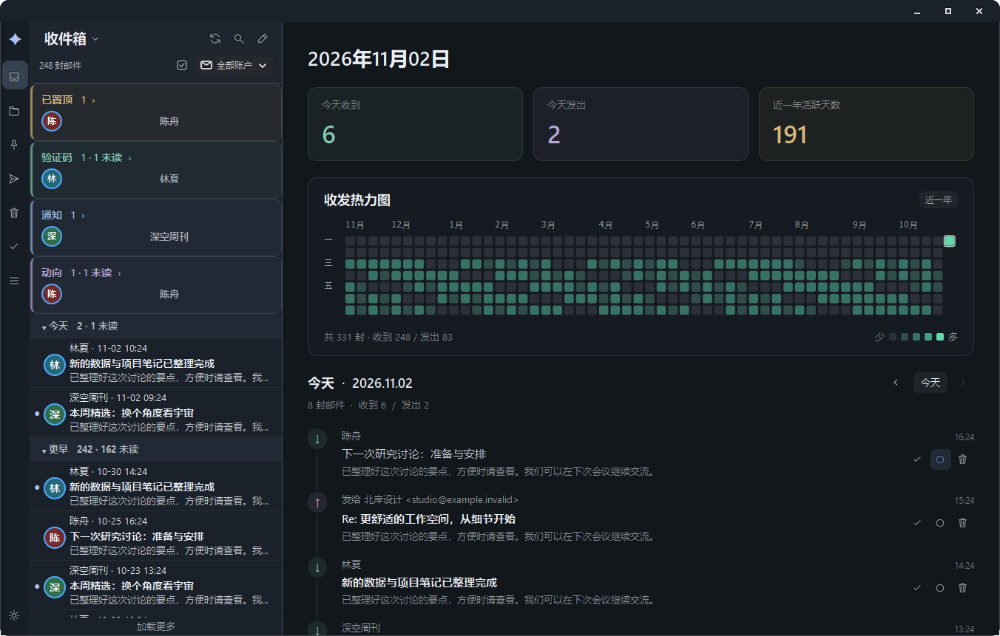

<div align="center">
  
  <h1>TeleMail</h1>
  <p>本地优先的桌面邮件客户端，支持 Windows 与 Linux。</p>
  <p><a href="README.md">English</a> · <strong>简体中文</strong></p>
  <p><a href="https://github.com/Syoong-s/OpenMail/releases/tag/v0.57.0">下载 0.57.0</a> · <a href="#开始使用">开始使用</a> · <a href="docs/BUILDING.md">从源码构建</a></p>
</div>



<p align="center"><sub>中文界面 · 聚焦收件箱、每日收发统计与邮件时间线。截图中的邮件均为合成演示数据。</sub></p>

TeleMail 将多个邮箱、聚焦收件箱和联系人对话整合到同一个工作空间。邮件操作先在本地生效，再由后台隐式同步。邮件、凭据和附件预览保留在你的电脑上；客户端直接连接邮箱服务商，不依赖 TeleMail 自建云服务，也不上传遥测数据。

## 更从容地处理邮件

| 工作空间 | 可以做什么 |
| --- | --- |
| **四种收件箱视图** | 在聚焦列表、未读卡片、简洁列表和对话列表之间切换，无需重新整理邮箱。 |
| **每日邮件活动** | 查看近一年的收发热力图，回顾某一天的邮件，并在时间线直接完成归档、标为已读或移入废纸篓。统计使用缓存，随邮件变化更新。 |
| **本地即时操作** | 已读、置顶和移动立即反映在客户端；待同步修改持久保存并由后台处理。“完成”即归档邮件。 |
| **多账号统一管理** | 管理多个 IMAP/SMTP 账号、本地文件夹、智能文件夹、发件人筛选和自定义过滤规则。 |
| **对话与撰写** | 按联系人跨主题阅读，维护通讯录，使用模板、稍后发送和跟进提醒。 |
| **舒适的阅读体验** | 深浅主题、克制的辅助配色与可调字号；附件在本地预览，PDF 支持搜索和文字选择。 |

**内置简体中文和完整英文界面。** 在 **设置 → 外观 → 界面语言** 中选择，保存后重新启动 TeleMail。语言切换只影响界面，不翻译邮件、联系人、自定义名称或文件夹标识。

## 开始使用

从 [GitHub Releases](https://github.com/Syoong-s/OpenMail/releases/tag/v0.57.0) 下载对应平台的发行包。

| 平台 | 发行包 | 启动方式 |
| --- | --- | --- |
| **Windows 11 · x64** | `telemail-0.57.0-windows-amd64.zip` | 完整解压后，打开 `TeleMail-Windows-amd64/TeleMail.exe`。 |
| **Debian / Ubuntu · amd64** | `telemail-desktop_0.57.0_amd64.deb` | 执行 `sudo apt install ./telemail-desktop_0.57.0_amd64.deb`，随后从应用菜单启动，或运行 `telemail`。 |
| **Linux 可移动包 · x86-64** | `telemail-0.57.0-linux-amd64.tar.gz` | 解压后运行 `TeleMail-Linux-amd64/TeleMail`；使用 `--install-user` 注册应用菜单入口。 |

### 运行依赖

- **Windows：** 已内置 Python、GTK、OpenSSL 和 Antiword。系统需具备 Microsoft Edge WebView2 Evergreen Runtime，标准 Windows 11 通常已包含；若缺失，需自行安装。无需另装 Python 或 WSL。
- **Linux：** 需要 Python 3.12+、GTK 3.24+、Fontconfig、OpenSSL 3、WebKitGTK 4.1、SVG 加载器（`librsvg2-common`）及 glibc ≥ 2.34。DEB 已声明必要依赖，软件源提供兼容版本时由 `apt` 处理；可移动包不会安装依赖。旧式 `.doc` 预览另需可选组件 `antiword`。

实际最低 glibc 版本取决于构建主机，兼容性与打包细节见[构建指南](docs/BUILDING.md)。

### 连接邮箱

打开 **设置 → 账号**，或使用首次启动时的登录流程。选择 Gmail、Outlook、Microsoft 365 或通用 IMAP/SMTP 服务商，再验证收件与发件服务。

支持密码／应用授权码。浏览器 OAuth 登录需要自行注册的 Google 或 Microsoft 客户端配置；TeleMail 不内置公共 OAuth Client ID。

> **添加账号后，请检查自动整理策略。** 默认会将收件箱中**超过 365 天且未置顶**的邮件移至该账号的服务器垃圾箱，邮箱服务商可能随后清空。若需保留全部收件箱邮件，请在 **设置 → 储存空间** 关闭自动整理或调整保留天数。

### 从源码体验

安装 Linux 运行依赖后，在仓库根目录执行：

```bash
./run.sh
./run.sh --demo   # 独立演示邮箱，仅使用合成邮件，不访问真实账号或外发邮件
```

常用命令：

```bash
TeleMail --demo
TeleMail --config <配置文件> --data <数据目录>
TeleMail mailto:user@example.com   # 打开未发送的草稿
TeleMail --version
```

## 使用细节

- **阅读与布局：** 界面字号支持 10–32，默认 14；外观即时预览，保存后保留，取消则恢复。浮窗尺寸随界面字号调整，邮件正文和 PDF 缩放使用各自设置。
- **多显示器：** Windows 使用整窗兼容缩放；副屏上的非整数缩放可能略柔和。大型编辑浮窗可临时扩大主窗口，并保留手动调整的尺寸。
- **离线文档：** 内置 PDF.js 6.4.299，通过私有 localhost 地址运行，支持滚动、缩放、文字选择、搜索和密码解锁，不上传文档。扫描图片型 PDF 不提供 OCR。
- **稍后发送：** 按时投递需保持应用运行；关闭期间到期的计划会在下次启动时处理。阅读回执取决于收件客户端，收件人也可以拒绝。
- **本地存储：** 凭据、远程图片、邮件缓存和清理行为详见[隐私与数据说明](docs/PRIVACY.md)。

## 文档

[构建与测试](docs/BUILDING.md) · [开发说明](Develop.md) · [本地即时操作与同步](docs/LOCAL_FIRST_SYNC.md) · [邮件概览](docs/MAIL_OVERVIEW.md) · [界面翻译](docs/LOCALIZATION.md) · [更新记录](docs/CHANGELOG.md)

## 开源协议

TeleMail 自有代码、原生适配层与构建脚本采用 [MIT License](LICENSE)。第三方组件保留原有许可证，详见 [NOTICE](NOTICE) 与[第三方组件说明](docs/THIRD_PARTY.md)。

Windows 组合二进制包含 Antiword，并间接加载受 GPL 条款约束的 JBIG-KIT。因此，组合发行包整体按 **GPLv3 或更高版本**提供并附带对应源码，TeleMail 自有代码仍采用 MIT 许可。详见 [Windows 组合分发说明](docs/WINDOWS_LICENSE.md)。
