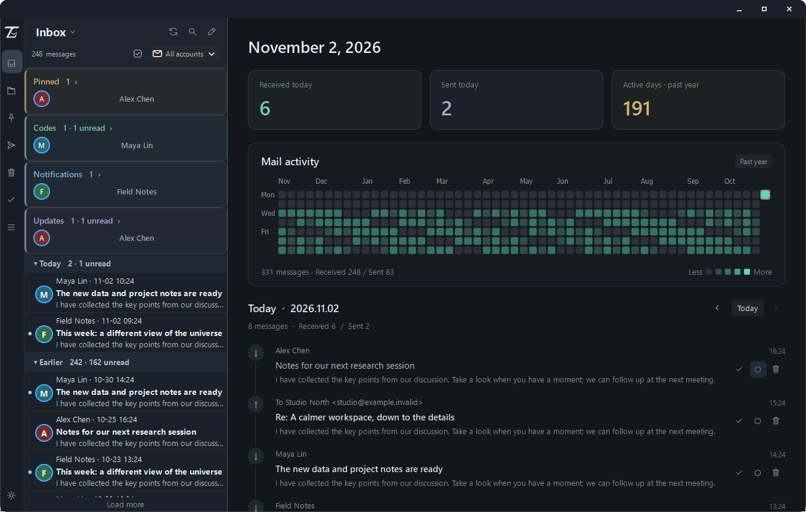

<div align="center">
  
  <h1>TeleMail</h1>
  <p>A local-first desktop email client for Windows and Linux.</p>
  <p><strong>English</strong> · <a href="README-CN.md">简体中文</a></p>
  <p><a href="https://github.com/Syoong-s/OpenMail/releases/tag/v0.57.1">Download 0.57.1</a> · <a href="#get-started">Get started</a> · <a href="docs/BUILDING.md">Build from source</a></p>
</div>



<p align="center"><sub>English interface · Focused inbox, daily activity and a linked mail timeline. All messages shown are synthetic.</sub></p>

TeleMail brings multiple accounts, a focused inbox and contact conversations into one workspace. Mail operations update locally and sync quietly in the background. Your messages, credentials and attachment previews stay on your computer; the client connects directly to your email providers, with no TeleMail cloud service or telemetry uploads.

## A quieter way to handle email

| Your workspace | What you can do |
| --- | --- |
| **Four inbox views** | Switch between Focused, Unread cards, Classic and Conversations without reorganizing your mailbox. |
| **Daily activity** | See received and sent mail across the year, revisit a day, and archive, mark read or trash messages directly from its timeline. Statistics are cached and updated when mail changes. |
| **Immediate local actions** | Read status, pins and moves appear locally first. Durable pending changes sync in the background; **Done** archives the message. |
| **One home for your accounts** | Use multiple IMAP/SMTP accounts, local folders, smart folders, sender screening and custom filters. |
| **Conversations and writing** | Follow contacts across subjects, manage your address book, use templates, schedule sending and set follow-up reminders. |
| **Comfortable reading** | Choose light or dark themes, restrained companion colors and adjustable text sizes. Preview attachments locally, including PDFs with search and text selection. |

**English and 简体中文 are included.** Choose **Settings → Appearance → Interface language**, save, then restart TeleMail. Language changes affect the interface, not your mail, contacts, custom names or folder identities.

## Get started

Download a package from [GitHub Releases](https://github.com/Syoong-s/OpenMail/releases/tag/v0.57.1).

| Platform | Package | Launch |
| --- | --- | --- |
| **Windows 11 · x64** | `telemail-0.57.1-windows-amd64.zip` | Extract the complete archive, then open `TeleMail-Windows-amd64/TeleMail.exe`. |
| **Debian / Ubuntu · amd64** | `telemail-desktop_0.57.1_amd64.deb` | Install with `sudo apt install ./telemail-desktop_0.57.1_amd64.deb`, then launch TeleMail from the app menu or run `telemail`. |
| **Linux portable · x86-64** | `telemail-0.57.1-linux-amd64.tar.gz` | Extract, then run `TeleMail-Linux-amd64/TeleMail`. Use `--install-user` to register an app-menu shortcut. |

### Runtime requirements

- **Windows:** Python, GTK, OpenSSL and Antiword are bundled. Microsoft Edge WebView2 Evergreen Runtime must be available; standard Windows 11 installations normally include it. If it is missing, install it yourself. Neither Python nor WSL needs to be installed separately.
- **Linux:** Python 3.12+, GTK 3.24+, Fontconfig, OpenSSL 3, WebKitGTK 4.1, an SVG loader (`librsvg2-common`) and glibc ≥ 2.34. The DEB declares its required dependencies; `apt` resolves them when compatible versions are available. Portable archives do not install dependencies. Optional `antiword` is needed for older `.doc` previews.

The actual minimum glibc version depends on the build host. See the [build guide](docs/BUILDING.md) for compatibility and packaging details.

### Connect an account

Open **Settings → Accounts** or the first-launch sign-in flow. Choose Gmail, Outlook, Microsoft 365 or a generic IMAP/SMTP provider, then verify the receiving and sending services.

Password/app-password authentication is supported. Browser OAuth sign-in requires your own registered Google or Microsoft client configuration; TeleMail does not ship public OAuth client IDs.

> **Check automatic cleanup after adding an account.** By default, unpinned inbox messages older than **365 days** are moved to that account's server Trash folder, which your provider may later empty. To retain all inbox mail, disable automatic cleanup or adjust the period in **Settings → Storage**.

### Try it from source

With the Linux runtime dependencies installed, run from the repository root:

```bash
./run.sh
./run.sh --demo   # Isolated synthetic mailbox; no real account access or outgoing mail
```

Useful commands:

```bash
TeleMail --demo
TeleMail --config <file> --data <directory>
TeleMail mailto:user@example.com   # Opens an unsent draft
TeleMail --version
```

## Details that matter

- **Reading and layout:** Interface font sizes range from 10–32, with a default of 14. Settings preview immediately; Save keeps changes and Cancel restores them. Popup sizes follow the interface font. Message text and PDF zoom have separate settings.
- **Multiple displays:** Windows uses system-aware whole-window scaling. Fractional scaling on secondary displays may look slightly softer. Large editors can temporarily enlarge the window while preserving manual resizing.
- **Offline documents:** The bundled PDF.js 6.4.299 viewer runs through a private localhost endpoint. It supports scrolling, zoom, text selection, search and password unlocking, without uploading documents. Image-only scans do not gain OCR.
- **Scheduled mail:** Keep the application open for on-time delivery. Overdue schedules are handled on the next launch. Read receipts depend on the receiving client and may be declined.
- **Local storage:** Read the [privacy and data policy](docs/PRIVACY.md) for credential storage, remote images, cached mail and cleanup behavior.

## Documentation

[Build & test](docs/BUILDING.md) · [Developer guide](Develop.md) · [Local-first sync](docs/LOCAL_FIRST_SYNC.md) · [Mail activity](docs/MAIL_OVERVIEW.md) · [Localization](docs/LOCALIZATION.md) · [Changelog](docs/CHANGELOG.md)

## License

TeleMail's original code, native adaptation layers and build scripts are licensed under [MIT](LICENSE). Third-party components retain their own licenses; see [NOTICE](NOTICE) and [Third-party components](docs/THIRD_PARTY.md).

The combined Windows binary distribution includes Antiword and indirectly loaded JBIG-KIT components under GPL terms. That combined distribution is provided under **GPLv3 or later**, with corresponding source, while TeleMail's original code remains MIT-licensed. See [Windows distribution licensing](docs/WINDOWS_LICENSE.md).
